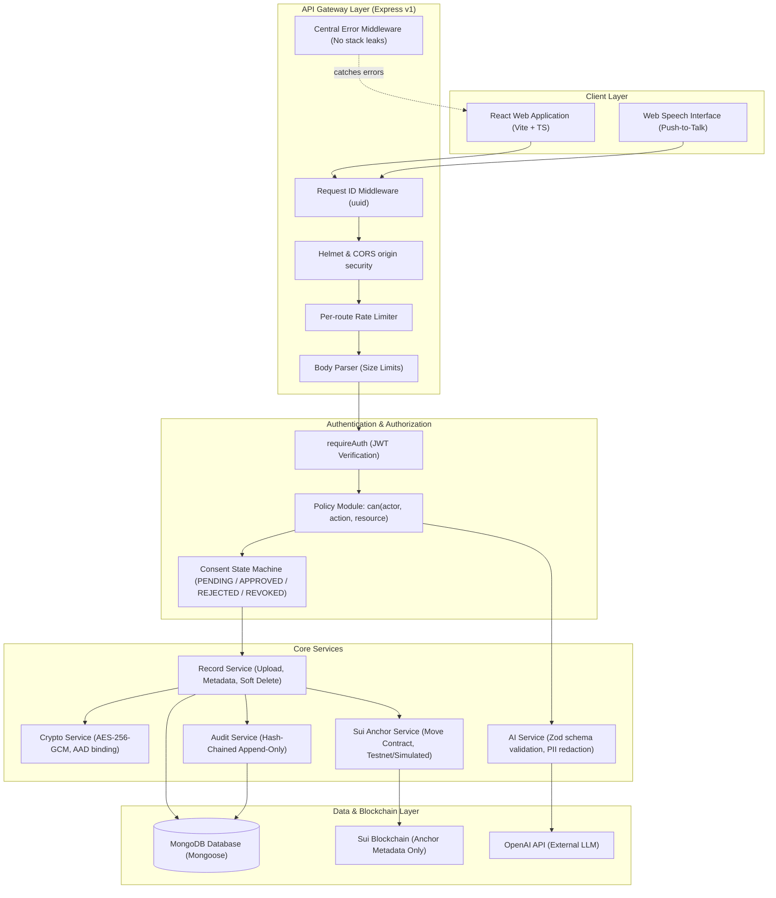
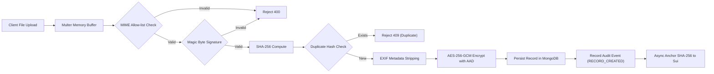

# MediChain-AI Architecture

## High-Level Architecture Diagram

---

## Data Pipeline: Record Upload & Ingestion

---

## Security Boundaries & Guarantees

1. **Deny-by-Default Policy Engine:**
   - Every request touching records, audit logs, or AI features routes through `can(actor, action, resource)`.
   - Patients have full control over their own records only.
   - Doctors can only view/download records if they hold an `APPROVED`, unexpired, unrevoked `AccessRequest` matching the requested record.
   - Doctors cannot update or delete records under any condition.

2. **Cryptographic Protection at Rest:**
   - AES-256-GCM authenticated encryption.
   - Fresh random 12-byte IV per encryption operation.
   - Authentication tag stored alongside the ciphertext.
   - Additional Authenticated Data (AAD) bound to `recordId|patientId` to prevent ciphertext relocation attacks.

3. **Tamper-Evident Hash-Chained Audit Trail:**
   - Each audit entry contains `prevHash` and `hash = SHA256(canonicalJson(entry) + prevHash)`.
   - Any modification to past entries breaks the verifiable hash chain.

4. **Zero Document Leaks On-Chain:**
   - No medical documents, patient PII, or document contents are ever committed to the blockchain.
   - Only the record's cryptographic digest (`SHA-256`), record ID, and owner address are anchored to Sui.

5. **Safe AI & Voice Interaction:**
   - System prompt instructs model never to diagnose or prescribe.
   - Direct PII redacted before sending text to external providers.
   - LLM responses strictly validated against Zod schemas; schema errors return controlled fallbacks.
   - Voice actions altering state require explicit confirmation tokens.
