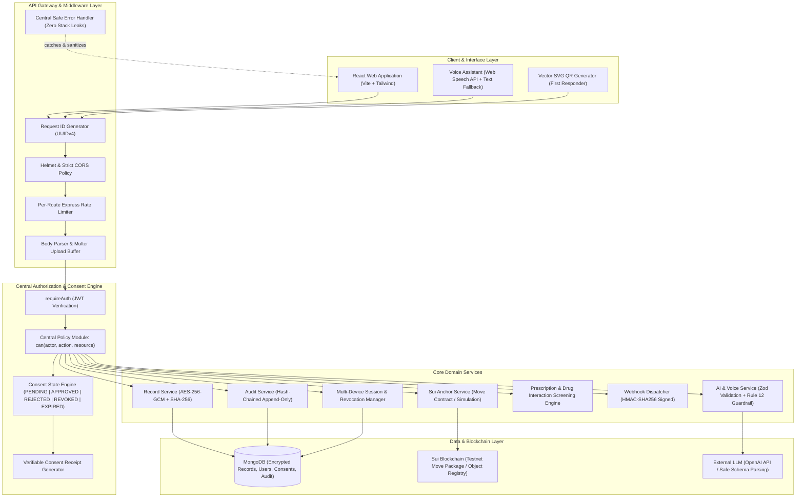
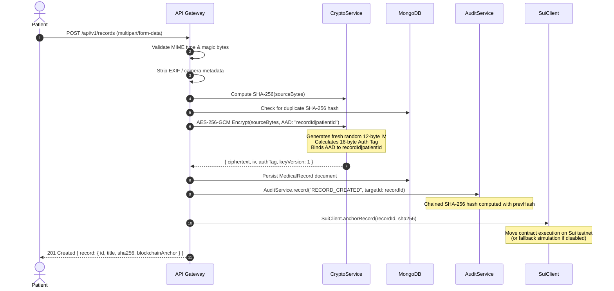

# MediChain-AI Architecture & System Design

> **High-Assurance, Patient-Controlled Medical Records Architecture with Cryptographic Privacy and Decentralized Integrity Anchoring.**

---

## 1. Architectural Philosophy & Zero-Trust Posture

MediChain-AI is designed under a strict **Zero-Trust & Deny-by-Default** security model:
1. **The Client is Untrusted:** The frontend application is strictly a user interface and presentation layer. It never acts as a security boundary. All authorization policies and boundary checks are evaluated and enforced exclusively on the server.
2. **Medical Data is Never Plaintext at Rest:** Medical records and clinical notes are encrypted using **AES-256-GCM** with authenticated data binding.
3. **Medical Data Never Touches the Blockchain:** Only cryptographic digests (SHA-256 source hash, record UUID, patient pseudo-identity) are submitted to the Sui Move contract.
4. **Audit Logs are Cryptographically Tamper-Evident:** Every sensitive operation generates a log entry linked to its predecessor via SHA-256 chaining. If any entry is modified, deleted, or inserted out of order, the entire chain fails mathematical validation.
5. **AI Output is Untrusted and Schema-Bounded:** External Large Language Model responses are validated against strict Zod schemas, stripped of diagnostic pretensions, and bound by explicit non-medical disclaimers.

---

## 2. High-Level System Architecture



---

## 3. Cryptographic Storage Pipeline (Rules 7 & 8)

When a patient uploads a medical document, the system executes the following deterministic security sequence:



### Additional Authenticated Data (AAD) Binding
To prevent **ciphertext relocation attacks** (where an attacker copies ciphertext from Alice's record and attaches it to Bob's record), the AAD is cryptographically bound to:
$$\text{AAD} = \text{recordId} \mathbin{\Vert} \text{patientId}$$
During decryption:
- If an adversary attempts to decrypt Alice's ciphertext in the context of any other record ID or patient ID, the AES-256-GCM GCM tag verification fails immediately with `AppError(400)`.

---

## 4. Central Authorization Policy Matrix (Rule 6)

Authorization is centralized entirely in `backend/src/policy/policy.ts`. Access control decisions are evaluated according to the following strict policy matrix:

| Actor Role | Action | Target Resource | Authorization Rule |
|---|---|---|---|
| **PATIENT** | `record:create` | Self | **ALLOW** |
| **PATIENT** | `record:read` / `download` | Record | **ALLOW** if `actor.userId === record.patientId`, else **DENY** |
| **PATIENT** | `record:update` / `delete` | Record | **ALLOW** if `actor.userId === record.patientId`, else **DENY** |
| **PATIENT** | `access:decide` / `revoke` | Access Request | **ALLOW** if `actor.userId === request.patientId`, else **DENY** |
| **DOCTOR** | `record:create` | Medical Record | **DENY** (Patients own and author primary records) |
| **DOCTOR** | `record:read` / `download` | Patient Record | **ALLOW** only if active, unexpired, unrevoked consent with scope `VIEW` or `DOWNLOAD` exists, else **DENY** |
| **DOCTOR** | `record:update` / `delete` | Patient Record | **DENY** (Doctors cannot modify or delete patient records) |
| **DOCTOR** | `clinical_note:create` | Patient Record | **ALLOW** only if active consent exists, else **DENY** |
| **DOCTOR** | `prescription:create` | Patient Record | **ALLOW** only if active consent exists, else **DENY** |
| **ADMIN** | `admin:verify_doctor` | Doctor Profile | **ALLOW** |
| **ADMIN** | `record:read` / `download` | Patient Record | **DENY** (Admins cannot read medical payloads) |

---

## 5. Tamper-Evident Hash-Chained Audit Trail (Rule 9)

The audit log guarantees non-repudiation and tamper detection through cryptographic linking:

$$\text{hash}_0 = \text{SHA256}(\text{canonical}(\text{entry}_0) + \text{GENESIS\_HASH})$$
$$\text{hash}_n = \text{SHA256}(\text{canonical}(\text{entry}_n) + \text{hash}_{n-1})$$

### Canonical Serialization
To guarantee deterministic hashing regardless of JSON key ordering:
```typescript
export class AuditService {
  public static canonicalStringify(obj: Record<string, any>): string {
    const sortedKeys = Object.keys(obj).sort();
    const sortedObj: Record<string, any> = {};
    for (const key of sortedKeys) {
      if (obj[key] !== undefined) {
        sortedObj[key] = obj[key];
      }
    }
    return JSON.stringify(sortedObj);
  }
}
```

If an attacker modifies, deletes, or reorders any historical audit entry, `AuditService.verifyChain()` identifies the exact broken index, log ID, and hash mismatch.

---

## 6. Sui Move Blockchain Anchoring

The on-chain anchoring interface is declared in `sui/sources/record_registry.move`:

```move
module medichain::record_registry {
    use sui::object::{Self, UID};
    use sui::tx_context::{Self, TxContext};
    use sui::event;
    use std::vector;

    struct RecordRegistry has key {
        id: UID,
        owner: address,
    }

    struct RecordAnchoredEvent has copy, drop {
        record_uuid: vector<u8>,
        sha256_hash: vector<u8>,
        anchored_by: address,
        timestamp_ms: u64,
    }

    public entry fun anchor_record(
        _registry: &mut RecordRegistry,
        sha256_hash: vector<u8>,
        record_uuid: vector<u8>,
        ctx: &mut TxContext
    ) {
        let sender = tx_context::sender(ctx);
        event::emit(RecordAnchoredEvent {
            record_uuid,
            sha256_hash,
            anchored_by: sender,
            timestamp_ms: tx_context::epoch_timestamp_ms(ctx),
        });
    }
}
```

---

## 7. Safe AI & Voice Assistant Guardrails (Rules 11 & 12)

### Rule 11: Schema Validation & Non-Diagnostic Boundary
- External AI models are invoked strictly for summarization and translation.
- Output is parsed and validated using strict Zod schemas (`explainedRecordSchema`, `voiceIntentSchema`).
- Medical text is treated as **untrusted user input**, never executable instructions.
- All AI responses append explicit non-diagnostic disclaimers:
  > *"Educational and translation tool only. Not diagnostic or clinical advice."*

### Rule 12: Voice Action Preview and Confirmation
- Any voice intent that modifies platform state (e.g., `SCHEDULE_APPOINTMENT`, `APPROVE_CONSENT`, `CREATE_NOTE`) is flagged with `requiresConfirmation: true`.
- The system returns structured `previewData` to the client.
- The UI renders an interactive confirmation modal with visual preview before any backend state mutation can be dispatched.

---

## 8. Health & Diagnostic Subsystem (Checkpoint 16)

Designed for zero-downtime containerized production deployments:

| Endpoint | Purpose | Checks Performed | HTTP Success |
|---|---|---|---|
| `GET /api/v1/health` | Comprehensive System Status | Uptime, system memory, Node version, MongoDB connection state | `200 OK` |
| `GET /api/v1/health/live` | Liveness Probe | Express HTTP event loop responsiveness | `200 OK` |
| `GET /api/v1/health/ready` | Readiness Probe | MongoDB ping latency, encryption master key readiness | `200 OK` / `503 Unavailable` |
